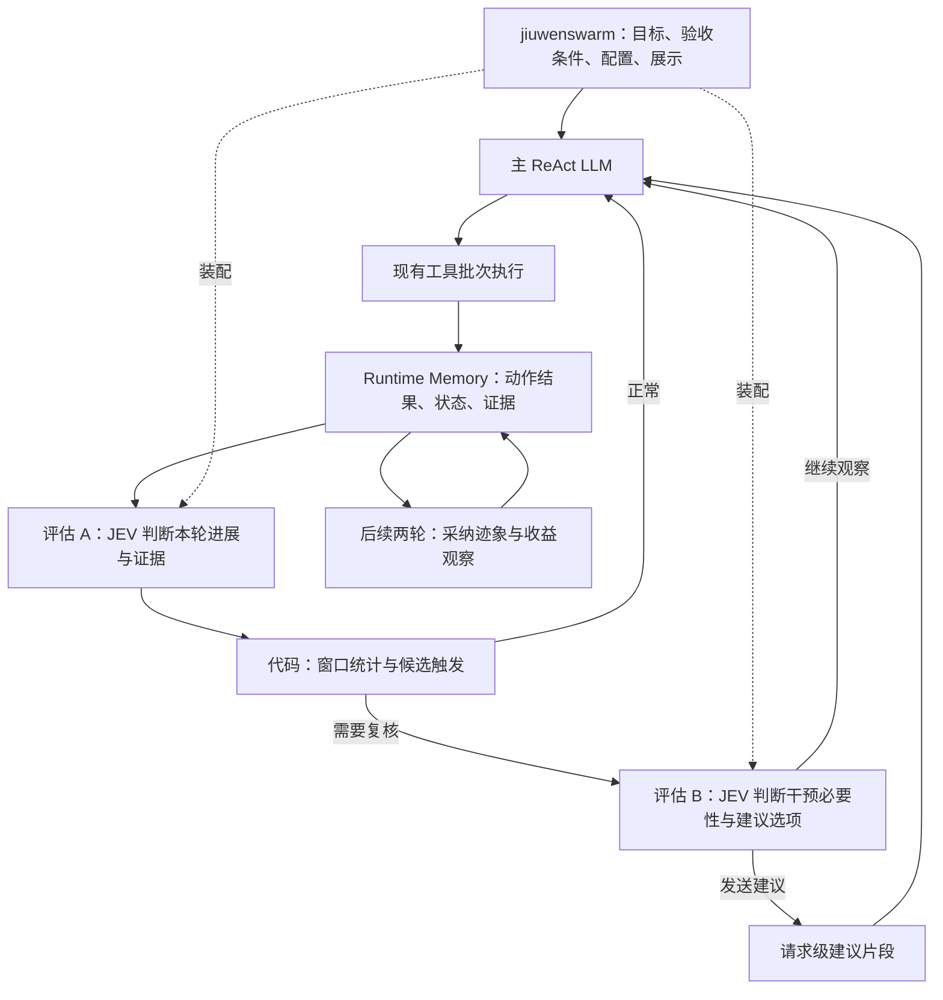

# ReAct、Runtime Memory 与 BAI 最小干预闭环

## 1. 本次设计结论

将原稿收缩为一个可独立交付的闭环：

**主 ReAct 执行动作 → Runtime Memory 记录观察 → JEV 评估进展与证据 → 代码更新窗口并发现异常信号 → JEV 复核与选择建议 → 主模型调整下一步 → 继续记录并观察干预效果。**

默认把需要语义判断、且能表达成有限选项的问题交给 JEV；代码负责真实结果、身份与去重、精确计算及控制流；主 ReAct LLM 负责生成具体计划和工具参数。保留统一评估接口，允许用 LLM 替换 JEV。用户所说的“动作预检”在本版体现为**下一次模型决策前，消费上一轮执行反馈**，不增加工具派发前的另一条审批链。

本期交付主 ReAct、Runtime Memory、BAI 三部分。成本预测和额度预留不纳入该机制；检查点、上下文截断、环境恢复、补偿和前向修复由独立恢复层以后集成。实际 token、耗时、费用有数据就记录，缺失就标记未知，不参与收益公式或新预算门禁。BAI 沿用原名称，本期实际提供“有限评估开销下的进展干预”，不宣称已经实现货币预算优化。

“回退”限定为**回到已有证据或假设，重新推理、重新规划**。建议不会删除历史消息，也不会撤销已执行工具的效果。第一阶段接入原生 ReActAgent 和 DeepAgent；第三方 provider 内部循环及团队统一监督不纳入。

本文是 2026-11-11 修订的目标方案，接口和算法尚待实现、校准与验证；不修改当前生产契约，不记录虚构审批。原标识、创建时间和作者保持不变。

## 2. 工程落点与最小架构

### 2.1 当前源码事实

| 已核对入口 | 当前行为 | 本次接入位置 |
|---|---|---|
| `ReActAgent._inner_invoke` | 主模型、工具批次、消息写入；正常完整轮末有 `AFTER_REACT_ITERATION` | 在完整批次结束后统一关闭 step，下一次模型调用前取建议 |
| `_execute_tool_call`、`_handle_resume` | 返回工具结果与 ToolMessage；支持暂停、恢复、多模态结果 | 从最终结果采集观察；暂停恢复沿用原 step |
| `AbilityManager.execute(..., on_tool_result=...)` | 可逐工具同步接收结果；重试开始会报告 None；回调可能被多次更新 | 只做部分结果保留，最终结果统一结算；不在回调中调用评估模型 |
| `_build_model_context_window` | 构建实际请求上下文；此前 callback 的 messages 可能只是预览 | 将建议作为本次请求的独立提示片段注入 |
| `JevSystemOneClient.system_one` | 独立 typed API；当前 SDK 支持 noul、choice、score | 复用客户端，新增运行进展与干预 rubrics |
| `DeepAgent` 内层 ReAct 与 rail 路由 | 内外层事件分开；rail 可以长期持有状态 | 转交同一个 monitor 配置，按会话隔离记录 |
| jiuwenswarm 的 `interface_deep.py` | 装配 DeepAgent、处理应用侧运行与展示 | 装配 evaluator，传入任务条件，展示干预原因与结果 |

`AFTER_REACT_ITERATION` 不覆盖所有 no-tool 结束、取消、暂停恢复路径；`AFTER_TOOL_CALL` 也可能在重试/取消时跳过。因此本方案不能仅挂一个 after-tool rail 就声称记录完整。现有 `retain_tool_facts_on_abort` journal 只解决批次中断时的事实保留，不等同于 Runtime Memory。

### 2.2 只有一个主循环



SDK 拟新增 `core/single_agent/runtime_monitor/`，初期四个实现文件足够：

| 文件 / 组件 | 责任 |
|---|---|
| `schema.py` | 配置、StepRecord、Observation、Assessment、Advice 等类型 |
| `memory.py / RuntimeMemory` | 有界记录、去重、窗口、干预状态；纯数据计算 |
| `evaluator.py / RuntimeEvaluator` | 两阶段评估协议；JevRuntimeEvaluator 与 LlmRuntimeEvaluator |
| `monitor.py / RuntimeMonitor` | 串联记录、评估、触发、提示和效果观察 |

另设包 `__init__.py` 导出需要用户装配的类型。上述均为拟新增路径。复用现有会话、上下文引擎、工具执行器和模型客户端，不引入第二个 Agent、独立 Memory 服务、向量库或通用工作流引擎。

SDK 拥有记录格式、窗口算法及控制流；业务适配器提供验收结果与有意义的状态字段；jiuwenswarm 提供目标与生命周期、配置和界面。领域知识不能硬编码进通用 ReAct。

## 3. Runtime Memory：事实、判断和轮次

### 3.1 一轮的定义

一个 step 是**一次主模型提案及其完整工具批次**。同轮并行调用 5 个工具仍是 1 个 step；同一工具内部 retry 不增加轮次；JEV/LLM 评估调用不算主循环轮次。

使用 `(agent_scope_id, session_id, task_id, step_seq)` 标识。agent_scope_id 绑定逻辑 agent/monitor，DeepAgent 重建内层 ReAct 时沿用，不能直接取临时对象 identity。当前 `react_iteration` 是局部计数，不能用作跨 invoke 的唯一键。暂停时保留同一 step 和待完成 tool_call_id；恢复后补齐并且只关闭一次。工具结果更新按 `(step_id, tool_call_id)` upsert，不能把中间回调重复累加。

进入窗口的 `eligible` step 必须有完整、可观察的决策结果：成功、终态错误或明确拒绝均可；等待用户、纯等待轮询、未完成批次和取消残留只记录，不计连续低收益。轮询豁免仅接受适配器声明的等待语义及明确未完成状态，不能因为工具名叫“wait”而自动豁免。

无工具的最终回答单独记录为终态，不为了评分强行续跑。若本来就有下一轮、且产生可验证的新产物，可由同一入口记录为 eligible；单纯“我觉得有进展”的文本不构成新增事实。既有迭代上限继续生效。

### 3.2 核心字段

| 记录 | 最小字段与语义 |
|---|---|
| 任务 | task_id、goal_version、goal_text、可选 acceptance_criteria；每条验收条件有稳定 criterion_id |
| StepRecord | step_id、status、actions、observations、state_changes、verified_deltas、usage、assessment、active_advice_id |
| Observation | obs_id、来源 tool_call/message/artifact 引用、有限摘录、content_hash、observed_at、可选 subject/property/scope/version |
| state_changes | 适配器提供的相关 before/after 或差异引用；未知则为空并注明 unavailable |
| verified_deltas | criterion_id、验证结果、proof_ref、验证对象版本；由注册验收器/宿主提供 |
| Assessment | gain_class/value、判定依据 obs_ids、置信度分布、backend/model/rubric_version、unknown_reason、input_coverage |
| WindowStats | step_ids、gain_sum/mean、valid_ratio、verified_progress_count、low_gain_streak、new_conflict_count、unknown_streak、repeat_count |
| Advice | advice_id、goal_version、memory_revision、trigger_codes、option_id、evidence_ids、目标引用、生命周期与后续结果 |

事实与模型判断分开存。JEV 高置信度不等于验收通过，主模型自报“完成”也不能增加 `verified_progress_count`。验收器必须检查具体产物/对象版本；例如工具运行成功只证明调用成功，测试通过是否满足某个任务目标还需要 criterion 映射。

实际 usage 区分 `main_model / tools / evaluator`，保留来源 request_id 及缺失状态。只有已有权威值才累加，按 request_id 去重；本期不新建全链路计费系统，不将缺失 cost 写成 0。

### 3.3 观察与证据怎样进入

默认适配器可直接从最终 ToolMessage 生成带引用的 Observation，无需每轮先调用 LLM 摘要。它记录的是“工具报告了什么”，不把任意文本自动升级为真实世界事实。输出太长时按明确规则截取并保留原始引用、truncated 标记；评估器看不到完整材料时可以返回 UNKNOWN。

业务 EvidenceAdapter 可补充结构化事实键、相关状态差异、验收结果；没有适配器仍可做语义监控，但不能宣称通用文件变化、浏览器变化就是目标进展。可选 LLM 适配器用于自由文本信息抽取，默认不启用；抽取内容仍带原文引用并标记 inferred。

同源相同内容先按 hash 去重；有结构化事实时按 `(subject, property, scope, version, normalized_value)` 合并。不同网页复述同一事实不自动变成多个收益，JEV 还需比较历史观察判断语义新颖性。来源不同可以增加支持度，但只有补上明确证据缺口才算新证据收益。推翻一个错误假设也可能是有用进展。

### 3.4 保存范围

初始上限为最近 32 个 step、64 条 Observation；保留当前窗口、活动建议和其引用，优先淘汰其他旧记录。验收条件状态、step 序号和累计 usage 另存小型摘要。去重与矛盾检测声明其有限历史覆盖，不能把被淘汰且未提供的资料视为已比较。

普通暂停/恢复将可序列化数据放在现有 session state 的专用命名空间；evaluator/client/锁不序列化。内存态与会话态必须同一个写入权威。沿用现有保存时点，不增加 WAL 或崩溃恢复保证。任务结束释放运行对象，保留宿主选择输出的摘要。新目标用新 task_id；同任务修订目标增加 goal_version、清空旧窗口及活动建议，历史结果仍可查。

## 4. JEV 的能力分配与替换接口

### 4.1 默认 JEV 优先

当前 SDK 暴露的是 `noul`（是/否概率）、`choice`（给定选项及分布）、`score`（有序量表及分布），不是自由生成对话接口。官方也建议把独立语义问题组合调用、将确定性流程留在代码中。[TypeSafe 官方构建指南](https://docs.typesafe.ai/concepts/how-to-build-with-system-one)

| 问题 | 默认实现 | 边界 |
|---|---|---|
| 新观察是否相关、新颖、推动目标 | JEV choice | 参照明确目标和提供的历史；可返回 UNKNOWN |
| 两条证据是否冲突，还是时间/版本变化 | JEV choice | 比较指定 pair，保留双方引用 |
| 当前动作是否偏离目标 | JEV noul | 作为额外复核信号，不修改事实 |
| 异常是否值得发送干预建议 | JEV noul | 输入已计算的窗口、动作结果与候选原因 |
| 继续、检查、换方向、推理回退的建议选项 | JEV choice | 只在代码构造的有限菜单中选择 |
| 后续动作是否响应建议、是否处理目标问题 | JEV choice/noul | 观察判断，不声称证明因果 |
| 去重、窗口均值、计数、引用校验、冷却 | 代码 | 精确运算不外包给模型 |
| 生成新方案、具体工具参数、开放式解释 | 主 ReAct LLM；必要时独立 LLM evaluator | JEV 只选择已有选项，不生成任意文本或工具调用 |

不把 JEV 的一次大问题写成“阅读全历史，自己完成所有监督”。以下两阶段把有依赖的步骤分开；同一请求内各问题读取同一个明确输入，不能让一个问题暗中引用另一个问题尚未返回的答案。该分工与官方关于独立判断和代码组合的边界一致。[TypeSafe 官方说明](https://typesafe.ai/blog/dont-call-it-a-decision-model)

### 4.2 一个协议，两种后端

以下为拟新增契约，返回本设计的类型，调用方不依赖某家模型的原始响应：

```python
class RuntimeEvaluator(Protocol):
    async def assess_step(self, data: StepEvaluationInput) -> StepAssessment: ...
    async def review_intervention(self, data: ReviewInput) -> InterventionReview: ...
```

`JevRuntimeEvaluator` 默认实现两个方法；`LlmRuntimeEvaluator` 用结构化输出实现同样契约，并可选补充短说明。公共结果使用等级、证据引用和明确的 uncertain 状态，原始概率为可选诊断字段。JEV 适配器按下文阈值归一化；LLM 自报置信度不能冒充 JEV 概率，需要独立校准。可以整体替换，也可在装配时分别选择两阶段后端；无需改窗口算法或主循环。LLM 返回的自由文本不得绕过 option/evidence 引用验证。

可配置一个备用 evaluator；默认失败走规则降级，避免一次 JEV 超时引出无限 LLM 重试。显式启用 LLM 备用时，每个 step 最多备用 1 次，备用失败即结束本轮评估；不递归调用。换后端时记录 model/rubric 版本，跨版本的历史分数只作观察，不能伪装成完全同标尺评测。

## 5. 评估 A：每轮收益和证据

### 5.1 输入与问题

每个 eligible step 一次 JEV 请求。输入限定为目标/验收条件、当前完整动作结果、最近 N 轮摘要及相关历史观察、活动建议；保留 obs_id 和来源。初始最多 8 条本轮观察、3 个冲突候选对，总输入上限 12,000 字符；优先验收结果和相关状态，再选与目标相关的观察，稳定截取。超过上限记录 coverage，不默认为其余材料没有进展。

同一请求包含以下独立问题，数量随实际候选减少：

- `gain:<obs_id>`：这条观察相对提供的历史产生哪类收益？choice = NEW_EVIDENCE / STATE_PROGRESS / NO_GAIN / UNKNOWN。
- `relation:<pair_id>`：两条材料是 CONTRADICTION / COMPATIBLE / STATE_UPDATE / UNKNOWN？
- `off_track`：当前动作与已有结果是否表明正在偏离目标？noul。
- 有活动建议时，加 `followed_advice`（YES / NO / UNKNOWN）和 `addressed_target`（noul），一起观察建议反馈。

每个 gain 问题独立读取原始结果与历史，不读取其他 gain/relation 的答案；代码在响应后组合。verified_deltas 由验收器产生，JEV 可以评价材料含义，但不替代验收器的通过位。

### 5.2 可解释的收益量表

| 分类 | g 候选值 | 成立条件 |
|---|---:|---|
| VERIFIED_PROGRESS | 1.00 | 至少一项有效验收条件首次从未通过变为通过，且 proof_ref 与当前对象版本匹配 |
| NEW_EVIDENCE | 0.50 | JEV 判断补上目标相关信息缺口，或有证据地排除错误假设；重复内容不算 |
| STATE_PROGRESS | 0.25 | JEV 判断相关状态更接近目标，有前后变化依据；尚未完成验收 |
| NO_GAIN | 0.00 | 观察完整且可判定，没有新增相关证据或状态改善 |
| UNKNOWN | null | 资料缺失、关键内容未覆盖、置信度不足或评估失败 |

这是一套初始工程量表，数值不是收益金额或客观完成比例。采用 choice 后代码映射，避免把任意 score 的量表尺度直接当作本系统收益。以后如改用 score，必须明确 criteria 对应值和版本。

组合规则：

1. 去重后，新增有效 verified_delta 优先得 1；同一 criterion 重复通过不重复奖励。验收条件后来失效需要另记 invalidation，恢复同一条件不算全新的里程碑。历史收益保留当时的验证事件，当前验收状态另列；失效事实进入下一次复核。
2. 其余从已接受的观察分类取最大值，不按工具数或证据条数累加；同一个结果不能同时叠加“新证据”和“状态改善”。
3. 有明确正收益时可接受这个下界，同时保留输入不完整标记；不完整材料不能支持 NO_GAIN。没有正收益且任一必要观察未知/未覆盖，则 g=null；全部必要观察均有效且无收益，才得 0。
4. 语义收益记 `basis=jev/llm`；`verified_progress_count` 只统计验收器提供的新通过事件。不可将 JEV 的“看起来有进展”写成“已验证进展”。

初始选择接受阈值：所选项概率 ≥ 0.75，且与第二项概率差 ≥ 0.20。低于阈值记 UNKNOWN；保留原始 confidence 作诊断，不把它宣称为本业务已经校准的准确率。确定性完全重复、已明确没有新状态的结果可直接标 NO_GAIN；未知副作用或未完成结果不满足这个条件。

### 5.3 矛盾计数

代码先构造候选 pair：优先同 criterion、subject/property/scope 的材料；无结构化键时，在当前观察与最近相关观察间按显式主题标签或文本关键词选取最多 3 对。无可比较材料则记录覆盖不足，不输出“没有矛盾”的强结论。需要更完整候选时由业务适配器提供，不在本期建通用知识图谱。

JEV 比较对象、范围、时间/版本、来源和内容。状态从 v1 变为 v2、不同环境的数据、一个材料未提及另一个材料，不能直接计为逻辑矛盾。UNKNOWN 保留为待验证。

冲突键用规范化双方证据键排序后生成；相同事实的不同转述先合并。满足阈值的同一冲突只在首次出现的 step 记一次，新来源重复报告不再次加计。保留 resolved 状态；窗口计数采用其中尚未解决的新增冲突。JEV 判定与验收器确认分别注明来源，不能混称已证实的事实冲突。

## 6. 最近 N 轮算法与候选触发

默认 N=5。窗口 W 是当前目标版本最近 5 个 eligible step；其长度 n 可以小于 5。设 K 为其中 g 非空的 step：

```text
valid_ratio = |K| / n                          # n=0 时为 0
gain_sum    = sum(g_i for i in K)
gain_mean   = gain_sum / |K|                    # |K|=0 时为 null
verified_progress_count = 新增有效验收通过事件数
new_conflict_count = W 内首次发现且尚未解决的不同冲突键数
```

`gain_mean` 只表示已评价部分；同时展示 valid_ratio，不用“缺失=0”补齐。不完整但有正收益的分数注明下界。实现只扫描 5 条记录即可，不引入复杂增量计算框架。

连续低收益定义为 g < 0.25。前 2 个 eligible step 是探索宽限期，期间低收益 streak 不增长；之后有确定低收益就 +1，有正收益就归零。UNKNOWN 将低收益 streak 归零并另增 unknown_streak；得到有效 g 时 unknown_streak 归零，不能把“0、未知、0”说成连续两次低收益。非 eligible 记录不参与计数。

| 候选 trigger_code | 默认条件 | 工程含义 |
|---|---|---|
| LOW_GAIN_STREAK | 宽限期后连续 3 轮 g < 0.25 | 当前方法可能停滞 |
| LOW_WINDOW_GAIN | 满 5 轮、valid_ratio ≥ 0.8、已计分值不含不完整输入的收益下界、gain_mean < 0.25 | 间歇的小变化仍未形成足够进展 |
| REPEATED_ACTION | 最近窗口同动作/规范参数/相关状态与结果指纹重复 ≥ 3 次，且这些结果无正收益 | 可能陷入重复；排除明确等待操作 |
| EVIDENCE_CONFLICT | 新增、未解决的不同冲突 ≥ 2 | 证据基础需要检查 |
| PREMISE_REFUTED | 新冲突涉及明确登记的当前计划前提，或验收器明确推翻该前提/此前有效的验收结论 | 单次也立即进入复核 |
| OFF_TRACK | A 的 off_track 概率 ≥ 0.8 | 补充识别阈值未覆盖的偏离 |
| ASSESSMENT_GAP | 连续 3 个 eligible step 为 UNKNOWN | 监控材料不足，不等于 agent 没有进展 |

这些条件产出“值得复核”的信号，不直接让主模型换方向；多个信号合并为一次评估 B。关键前提引用只接受已登记的 assumption/criterion ID；无这类结构时不猜测 PREMISE_REFUTED。阈值是首版默认值，需要用本项目轨迹调优。

## 7. 评估 B：是否干预、给哪类建议

### 7.1 输入与有限菜单

B 使用 **A 已写入、窗口已更新后的** Runtime Memory：目标、trigger_codes、窗口数值、引发异常的动作和证据引用、上次干预结果。不能用前一轮窗口复核当前异常。

代码按现有证据生成最多 8 个候选，每个候选都预先带有明确 target_ref 和观察条件。每类可有多个目标，但不展开组合搜索：

| 类型 | 发给主模型的含义 | 候选成立条件 |
|---|---|---|
| CONTINUE | 继续当前方法，在接下来两轮观察指定结果 | 有可解释的探索或等待验证过程 |
| VERIFY | 优先补证据、复查结果或核对矛盾 | 有 observation / criterion / conflict 目标；材料不足时可指向缺失观察 |
| REPLAN | 当前方法收益不足，围绕指定目标换方法 | 有目标 criterion 或任务本身；具体新计划由主模型生成 |
| BACKTRACK | 回到指定事实/假设重新推理，撤回无依据的推断 | 有可引用的既有事实锚点及需要重新检查的前提 |

BACKTRACK 菜单及模板明确写“不会撤销任何外部效果”；没有有效锚点就不提供该选项。REPLAN 也不由代码枚举各种具体新计划。VERIFY 的默认候选指向最早未解决的关键冲突，否则指向本次触发所缺的验证信息。

一次 B 请求包含两个独立问题：

1. `needs_intervention`（noul）：依据窗口与证据，是否值得现在向主循环发送纠偏/复核建议？
2. `advice_option`（choice）：**假如需要发送一条建议**，给定菜单里哪条最合适？

第二个问题只引用同一份输入和菜单，不引用第一个答案。结果由代码组合：noul ≥ 0.7 视为需要，≤ 0.3 视为暂不需要；中间为不确定。建议选项初始接受阈值为所选项概率 ≥ 0.65、领先第二项 ≥ 0.15。所有阈值可配置。

暂不需要时记录复核结论并继续主循环。不确定/选项无效时，显式配置的 LLM 备用可复核一次；否则对已有明确异常发一条低置信度 VERIFY 建议，对单一低置信度 off_track 信号继续观察。验收器已明确推翻当前前提时，最低发送 VERIFY，不让语义复核把这个事实静默忽略。以上均为软建议，不构成工具权限或风险门禁。

### 7.2 请求样例与响应校验

沿用 SDK 的真实 API；下面只展示 A 中两个问题的构造，项目 rubrics 要补全目标、重复、时间/版本及 UNKNOWN 条件：

```python
response = await jev.system_one(
    state=bounded_step_input,
    questions={
        "gain:o17": ChoiceQuestion(
            instructions="仅评价 current.observations.o17 相对 history 的目标相关收益。",
            criteria={
                "NEW_EVIDENCE": "新增相关证据，补上缺口或排除错误假设",
                "STATE_PROGRESS": "有依据的相关状态改善，尚未完成验收",
                "NO_GAIN": "材料完整，没有新增相关收益",
                "UNKNOWN": "材料不足或无法可靠判断",
            },
        ),
        "off_track": NoulQuestion(
            instructions="current.actions 和 observations 是否显示偏离 goal？"
        ),
    },
    request_timeout=1.5,
)
```

运行监控专用客户端显式配置 `max_retries=0`，不能沿用当前客户端 360 秒默认超时和 2 次重试。默认每阶段 1.5 秒截止，单轮最多 2 次 JEV 请求；普通轮只调用 A，触发轮再调用 B。失败不会重试同一输入。显式 LLM 后端使用独立超时配置，记录它带来的实际延迟。

适配器校验 question_id 与输入对应、类型匹配、选项来自菜单、所有数值有限且在合法范围；choice 概率覆盖所有选项、总和约等于 1（容差 0.01）、winner 为最大项。引用只能来自本次输入，不能让模型创造 evidence_id。某个 head 无效只将它标 UNKNOWN，不抹去其他有效结果。低概率结果不强行二值化。

模型输入中的工具内容按不可信观察处理，与系统 rubric 分字段；主模型和 evaluator 都不得把原文中的指令当作用户新增任务。具体来源和判定摘要保留，界面解释由“触发原因 + 窗口数字 + 选中目标”模板生成，无需要求 JEV 生成自由文本理由。

### 7.3 控制频率与降级

- 同一 `(task_id, goal_version, step_id, rubric_version)` 的 A 只提交一次；已经关闭的 step 重放不会重复评估。
- 一个 step 的所有异常合成一次 B。发出建议或完成一次 B 后，冷却 2 个 eligible step；新的关键前提被推翻可绕过冷却。
- 活动建议的观察期为 2 个 eligible step。普通新信号在此期间合并，避免同一模型轮收到多条互相竞争的建议；新的关键前提冲突可替换并将旧建议标 superseded。
- 同一异常阶段最多连续干预 2 次；仍无改善标记 stalled 并暂停重复提醒。异常键由 goal_version、原因、目标及证据指纹构成，不包含递增 step_id。出现目标进展/新相关证据、新目标版本或不同关键冲突时开始新的观察阶段；没有新材料的次数增长不算新原因。
- 同一输入不因后端报错无限请求；默认降级只利用已有 verified_deltas、完整重复结果、可计算窗口。其他语义结果记 UNKNOWN；连续缺失触发 ASSESSMENT_GAP 的 VERIFY 建议，不能假装 JEV 已判定停滞。
- evaluator 异常不改变工具执行结果；外部取消要及时传播。保留 degraded / timeout 状态，继续遵守现有主循环上限与终止条件。

“JEV 快”支持将它放在每轮路径，但不将厂商延迟当本项目 SLA。上线前测 A/B 的 p50、p95、超时率和额外 token；以调用次数、输入大小、截止时间约束开销。

## 8. 建议真正进入主循环，并验证后续结果

### 8.1 请求级建议

Advice 记录推荐类型和引用；发给主模型的是一个短片段，通常 300–600 字。示例：

```text
[runtime_intervention advice_id=a5 goal_version=2]
观察：最近 5 轮有 4 轮得到有效评价，平均收益 0.125；
探索宽限后连续 3 轮无新增收益。依据：s3/o7、s4/o9、s5/o10。
建议：VERIFY，先核对证据 o10 与验收条件 c2。
请据此选择下一步；若继续当前方法，应能说明待验证的结果。
后续观察：未来两轮是否补充了针对 c2 的证据或推进了验收。
本建议不能证明任务已完成；BACKTRACK 仅表示重审推理。
[/runtime_intervention]
```

具体动作仍由主 ReAct LLM 在正常工具协议中生成。保持用户目标与新指令的优先级；既有工具权限照常处理模型实际选择。无需要求主模型额外输出一套强制 JSON 决策，也不新增 recover 工具。

### 8.2 生命周期与效果

生命周期为 `created → delivered → observing → improved / no_observed_improvement / inconclusive`；目标变化或更新建议可进入 expired / superseded。delivered 只表明真实模型请求带上了该建议，不等于模型已采纳。连续两次有下一模型请求却未能装入建议时，记 expired 并附未送达原因，避免永久占用活动建议位置。

将 advice_id 与实际请求及其产生的 step 关联。之后 A 顺带判断后续动作是否响应建议、是否处理指定 target。代码在两轮后综合：

- 有针对该 target 的新验收通过；或同一后续 step 的 addressed_target ≥ 0.7 且 g ≥ 0.25：记 improved；只相关但尚无进展不满足此条件。
- 两轮收益及目标响应均可评价、目标未改善：记 no_observed_improvement。
- 材料不足、任务提前结束、取消或观察期未满：记 inconclusive；已出现明确目标改善可提前记录 improved。

“是否采纳”的判断单独保留 YES / NO / UNKNOWN，不能用收益提升反推一定采纳，也不能把同时发生的改善宣称为干预的因果效果。生成/送达建议不重置低收益计数；真正的新收益才重置。真正关闭且归属于使用该建议的模型请求的 step 才推进观察期限，JEV 调用和模型重试不推进。

### 8.3 一条可复演的轨迹

| step | 观察 | g | 低收益 streak | 结果 |
|---|---|---:|---:|---|
| s1 | 验收器首次确认子条件 c1 | 1.00 | 0 | 宽限期 |
| s2 | 获得与 c2 相关的新证据 | 0.50 | 0 | 宽限期 |
| s3 | 重复同一查询，无新事实 | 0.00 | 1 | 继续观察 |
| s4 | 改写查询，仍返回已知事实 | 0.00 | 2 | 继续观察 |
| s5 | 再次无新增收益 | 0.00 | 3 | A 后窗口均值 0.30；由连续低收益触发 B，选 VERIFY:c2 |
| s6 | 主模型按建议查验 c2，获得新证据 | 0.50 | 0 | 记录采纳迹象与目标改善 |
| s7 | c2 经验收首次通过 | 1.00 | 0 | 关闭观察期，保留结果及证据 |

这个例子故意让窗口均值尚不低，以说明“连续低收益”与“窗口平均收益”各有作用。若 s4 的材料不可评价，s4 应为 UNKNOWN，s5 的低收益 streak 只能是 1，不能按表中路径触发。

## 9. SDK 接入时序与接口

### 9.1 装配与任务边界

拟新增 `ReActAgent.set_runtime_monitor(monitor | None)`，DeepAgent 提供同名转交入口；monitor 未设置时行为不变。配置和依赖在 runtime 对象中，AgentCard/ToolCard 不增加本功能字段。DeepAgent 重建或重新配置内层 ReAct 时需要重新转交 monitor，不重复注册观察入口。

```python
monitor = RuntimeMonitor(
    config=RuntimeMonitorConfig(window_size=5, mode="active"),
    evaluator=JevRuntimeEvaluator(jev_client),
    # evidence_adapter 可选；缺省从最终 ToolMessage 提取 Observation
)
agent.set_runtime_monitor(monitor)
# 同样可以注入 LlmRuntimeEvaluator(model_client)，核心循环无须改变。
```

所有类型和方法均为拟新增接口，不能把示例当现有可运行 API。mode 可设 `observe`：照常记录、评估和产出建议，但不注入主模型，用于校准。

monitor 的数据按 agent/session/task 隔离；可复用无任务状态的 evaluator，不能共享窗口。宿主在调用入口传入稳定 task_id、goal_version 和验收条件；具体载体复用现有会话状态命名空间，由 monitor 提供初始化/更新方法。无宿主 task_id 时 SDK 首次调用生成，普通新任务新建；HITL/workflow resume 延续原 ID。DeepAgent 的多次内层 invoke 应由外层任务生命周期保持同一 ID，不能每次重新开始窗口。

### 9.2 关闭 step 与结果权威

主循环增加少量显式 monitor 调用，不新增 AgentCallbackEvent：

1. 有效模型响应产生时打开 step，登记本轮预期 tool_call_id 和本次使用的 advice_id。
2. `_execute_tool_call` 中按最终 `results` 采集 Observation；工具消息和对应多模态消息完整写入后，检查批次是否全部终态。
3. 正常结束和 `_handle_resume` 都调用同一个 `close_step_once`，先保存事实和待评估标记。有未完成工具则保留 partial；完整 step 只关闭一次。
4. 取消/异常只保留已知结果和 partial/aborted 状态，禁止从异常清理路径发起新的评估网络请求。
5. 下一次模型决策边界先处理现有 force_finish 和用户 steering，再对待评估完整 step 执行 A/B，随后构建实际模型请求。这样可看到最新约束，也不会在已决定结束后额外监督。
6. no-tool 终态或达到迭代上限只保存事实、可直接确认的验收结果及建议结局，不为评估强行续跑；最后一轮未做语义评估的部分明确标记未评价。

若需取消期间部分事实，组合已有 `on_tool_result` 回调，不覆盖原有 retention 行为。None 表示当前没有结果，不能累加一次失败；回调中只更新引用，最终 rail 处理后的结果优先。每工具 callback context 的 extra 可能隔离，不能假设根 ctx.extra 会自动汇总并发工具数据。

已被本轮其他 rail 请求 force_finish 的分支只完成必要记录，遵从原终止语义。所有 invoke/stream/resume 入口调用相同 helper，不为流式路径另写一套收益算法。

### 9.3 注入与并发一致性

在 `_build_model_context_window` 的实际上下文组装处，读取当前 session 的活动 Advice，添加**本次请求局部**片段，再交给 context engine；相应 usage 分类统计使用同一个真实窗口。不能全局修改 agent 共享的 prompt_builder，否则并发会话会串建议；只改 BEFORE_MODEL_CALL 的预览 messages 也可能随后被覆盖。

上下文压缩/截断后需检查 advice_id 确实仍在真实请求中；若因预算/终态策略移除，记录未送达，不能标 delivered。模型请求实际派发时记录 request_id；重试沿用同一建议，评估不会重做。独立 ReAct 与 DeepAgent 都需验证这一链路。不能把 `push_steering` 作为唯一注入方式，因为没有绑定队列时它可能不生效。

一次评估读取不可变快照，带 goal_version 和 memory_revision。提交结果时复核版本，过期则丢弃建议而保留诊断。网络等待期间不持有会话写锁；同任务控制器串行结算，工具依旧按现有策略并发。新用户约束在下一次模型调用前更新版本或使建议失效，不让旧建议覆盖用户意图。

### 9.4 闭环伪代码

```python
# 工具批次完整结束时先调用 memory.close_step_once(step) 保存事实。
# 下一次允许的模型决策边界执行；同 step 重放不会重复评估。
async def evaluate_pending_step(step):
    if not step.eligible or not memory.mark_assessment_started_once(step):
        return

    data = memory.freeze_step_input(step)
    assessment = await evaluator.assess_step(data)       # A；异常走有界降级
    if not memory.accept_if_current(data, assessment):
        return

    stats = memory.compute_window()
    memory.observe_advice_outcome(assessment, stats)
    signals = collect_candidate_signals(stats, assessment)
    if not policy.may_review(signals, memory):
        return

    review_input = memory.freeze_review_input(signals, build_options(memory))
    review = await evaluator.review_intervention(review_input)  # B
    if memory.is_current(review_input):
        memory.record_review_and_maybe_advice(review, signals)
# 下一次真实模型请求读取当前 Advice；实际动作由原 ReAct loop 执行。
```

伪代码省略了取消传播、超时及逐字段校验，不代表要求另建一套工具执行循环。

## 10. jiuwenswarm 接入与验证计划

### 10.1 应用最小改动

jiuwenswarm 在现有 `server/runtime/agent_adapter/interface_deep.py` 装配 monitor，提供目标/验收条件和稳定任务身份。配置开放 window_size、触发阈值、评估后端、截止时间及 observe/active。凭据走现有模型配置，不写入 Runtime Memory 或提示。

界面首期展示窗口收益与有效覆盖率、已验证进展数、连续低收益/冲突数、建议类型和依据引用、送达及后续观察结果。actual usage 可附带展示。先使用已有事件/日志出口传递版本化摘要，不增加服务或数据库表。重载配置只影响新评估；若 rubric/量表改变，启用新的监控版本和窗口，不能混算不同量表。

### 10.2 通过条件

以下是开发阶段应实现的验证，不是本次已执行的测试：

| 场景 | 通过条件 |
|---|---|
| 正常、并行、retry、重复回调 | 一次提案只结算一轮；五个并行工具不制造五次低收益 |
| 暂停、恢复、取消、流式 | 暂停不评分，恢复只关闭一次；取消部分结果可查但不记零分 |
| 无工具终态、达到迭代上限 | 保持原结束语义；不因 BAI 强行续跑 |
| UNKNOWN 与不完整输入 | 缺失不按 0；低收益 streak 不跨 UNKNOWN；覆盖率准确 |
| 重复证据与状态差异 | 改写同一事实不自动奖励；无目标意义的文件 hash 变化不自动加分 |
| 验收来源 | JEV 高置信度不增加已验证进展；过期产物版本与重复验收不重复奖励 |
| 矛盾 | 相同冲突不反复计数；时间更新/不同 scope 不直接计矛盾；新关键冲突可绕过冷却 |
| 触发边界 | N、宽限期、阈值等号、冷却和 UNKNOWN 路径可用固定轨迹逐轮复算 |
| JEV 接口 | 独立 heads 同请求；B 读取 A 后的窗口；普通轮 ≤1、触发轮 ≤2 次 JEV |
| 异常与替换 | 超时/非法概率/无效选项有界降级；同一轨迹可替换 LLM evaluator；不形成回调重试环 |
| 实际提示 | 独立 ReAct、DeepAgent 的实际模型请求含正确 advice_id；跨会话无泄漏 |
| 闭环效果 | 记录送达、采纳迹象和目标改善；无改善抑制重复提醒；建议本身不重置 streak |
| 兼容 | monitor=None 的模型请求、工具调度、权限与已有返回结构保持兼容 |
| 回退建议 | BACKTRACK 仅改变建议/推理方向，不删除消息或改写环境状态 |

验证分两类：先用 stub evaluator、可控制工具与固定轨迹做确定性集成验证；再对真实业务轨迹做 JEV/LLM 离线标注比较，至少覆盖有效探索、重复搜索、错误循环、矛盾证据、缺失材料。测误触发、漏触发、建议可用性与延迟，不只测 JSON 能否解析。

### 10.3 交付顺序

1. SDK 实现记录、step 边界、窗口计算和 evaluator 协议；用 stub 复演本设计轨迹。
2. 实现 JEV 的 A/B rubrics、校验和降级；同时提供可替换的 LLM evaluator，实现同一测试契约。
3. 接通真实请求提示及两轮效果观察，完成独立 ReAct、DeepAgent 的闭环集成。
4. jiuwenswarm 先 observe 校准，再启用 active；不要求建设恢复层才能交付。

最小交付必须包含第 3 步：只有采集、评分和日志还不算干预闭环。开发前仍需以实际业务轨迹校准阈值和输入裁剪；无充分依据时使用本文默认值并标记实验配置。这不阻塞设计成稿，也不表示默认值已经经过效果验证。

## 11. 决策修订与后续交接

### 2026-10-29：原稿

原稿覆盖动作准入、成本预测/预留、运行账本、稀疏 JEV 评估、检查点与恢复。其主要理由是昂贵动作需要前置关注、外部副作用不能随上下文回退而消失。原稿未实现、未获批准，不构成当前 SDK 承诺。

### 2026-11-11：按用户收缩范围并采用 JEV 优先

本稿续写同一设计标识，替代原稿的本期实施范围：

- 保留“事实与模型判断分离、证据可追溯、主模型决定实际下一步、控制评估开销”。
- 将原来的动作前准入改为执行后的 Runtime Memory 反馈；本期不新增成本预测或风险审批。
- 将“规则主导、JEV 偶发参与”改为“JEV 承担各类有界语义判断，代码组合，LLM 可替换”；采用两阶段是因为窗口依赖 A 的结果，不能伪装成同请求内的顺序推理。
- 恢复层整体后移；保留其关键限制：推理回退不能被解释成外部效果已经撤销。以后确需工具撤销、文件恢复或补偿时，另行设计能力契约及验证，不能通过扩展 BACKTRACK 文案直接开放。
- 成本预测不纳入该机制，也不列为后续阶段。实际 usage 仅作为已有运行记录保留，不用于预测、动作准入或收益/价格优化。

全 LLM 每轮反思的代价是增加生成请求与不稳定输出；纯代码无法可靠判断语义新颖性；本版选择 JEV 主路径并保留 LLM 适配。没有引入多 Agent 监督、知识图谱或自学习阈值，因为当前闭环不需要这些前提。

用户于 2026-11-11 明确确认按新版设计实现 agent-core 的最小闭环，并要求使用新分支。设计转入 active / in-development；默认量表和阈值的效果校准仍须依赖业务轨迹。实际实现、偏差与验证由 jw-dev 记录在 feature 中，不回填为设计已验证的结论。

### 2026-11-12：jiuwenswarm 应用闭环与本地双仓联调

用户明确要求将 SDK 底座接入 jiuwenswarm 并逐步完善闭环，应用适配另建分支；联调使用本地 agent-core 的新分支。成本预测从路线中移除，恢复层由其他开发者独立负责，未来按明确能力契约集成。原先关于成本算法“后移”的决定被本修订替代。

第一阶段的实施边界是现有原生单 Agent DeepAdapter 的可用应用闭环：

1. `execution_guard.runtime_monitor` 配置 off/observe/active 及 JEV/LLM 后端；默认关闭，JEV 为默认后端。启用时使用专用零重试 client，随会话 adapter 创建、配置重载与 cleanup 管理。
2. 使用 SDK 已有任务/中断/steering 生命周期，不把每个 Web 请求都新建为监控任务。Session 中 RuntimeMemory 是事实源，应用仅投影。
3. SDK 提供可选异步快照通知 `on_update(session, memory)`，在评价边界和结束结算后触发，单次默认最多 0.25 秒，错误不能影响主执行；不建立后台轮询、全局事件总线或第二套评估循环。
4. 应用输出有版本的 `chat.runtime_monitor` 诊断快照，仅含标识、窗口、步骤概况和建议状态，不广播原始工具参数/证据/模型密钥。干预生命周期通过既有 `chat.notice` 展示；同一 advice 使用稳定 notice_id，实时与历史均更新同一通知。
5. 复用现有流式转发与历史保存，只为新事件补解析；不新建数据库、独立监控页面或一套持久化。
6. 本地 uv source 指向相邻 `../agent-core`，editable 安装；代码变更无需发布 SDK 即可联调。发布时再用实际合入的 SDK revision，不能编造发布提交。

第二阶段扩展具体业务 EvidenceAdapter：先选择一个真实任务类型，由实际工具提供带版本的验收 proof，再增加“已验证进展”的业务覆盖。第一阶段没有业务 adapter 时 verified 计数保持 0，不能用 TODO 状态或模型自报填充。

第三阶段使用 observe 的业务轨迹校准阈值、比较误触发与建议效果，再逐步扩大 active 范围。恢复层未来只接收明确的恢复请求与执行结果；当前 BACKTRACK 仍仅重审推理，绝不暗含恢复授权。

第一阶段验收应覆盖：实际应用装配；最终主模型请求含建议；默认关闭兼容；双会话隔离；暂停续跑；通知与历史去重/重建；通知写入失败不影响任务；JEV client 关闭；SDK 实际导入来自本地分支。模拟轨迹通过与真实 JEV 效果校准分别记录。

## 12. 依据与后续需同步的契约

源码核对以本地 2026-11-11 工作区为准：

- [ReAct 主循环、工具批次、resume 与真实上下文组装](../../../../../openjiuwen/core/single_agent/agents/react_agent.py)
- [AbilityManager 的最终结果与 on_tool_result](../../../../../openjiuwen/core/single_agent/ability_manager.py)
- [core rail 输入与 steering 接口](../../../../../openjiuwen/core/single_agent/rail/base.py)
- [System One 客户端](../../../../../openjiuwen/core/foundation/llm/system_one/client.py)、[typed schema](../../../../../openjiuwen/core/foundation/llm/system_one/schema.py)、[公开导出](../../../../../openjiuwen/core/foundation/llm/system_one/__init__.py)
- [DeepAgent 装配与内外循环](../../../../../openjiuwen/harness/deep_agent.py)
- [现有 rail 契约](../../../specs/harness/S_04_rails-contract.md)、[浏览器 JEV 实施记录](../../../features/harness/F_07_browser-jev-policy.md)：浏览器的具体决策策略继续属于其自身模块，本方案只复用 core 客户端。
- 应用侧已核对 `D:/jiuwenswarm/jiuwenswarm/server/runtime/agent_adapter/interface_deep.py` 的 DeepAgentConfig 装配；本次不修改该仓库。
- [TypeSafe：独立问题、代码组合与不确定性处理](https://docs.typesafe.ai/concepts/how-to-build-with-system-one)、[TypeSafe：判断与控制流的边界](https://typesafe.ai/blog/dont-call-it-a-decision-model)。

开发需要新增 runtime monitor 的有效 spec、公开导出与使用示例；如触及现有 rail、prompt/usage、resume 契约则同步对应 spec。当前阶段仅修订设计并自动同步文档索引，不改现行 spec 或实现。


